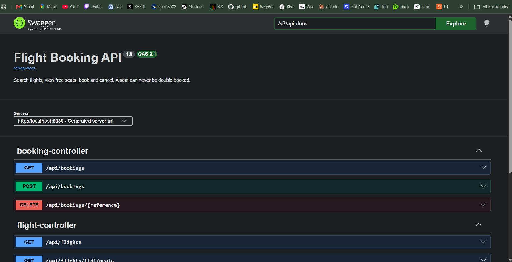

# Flight Booking API


A REST API for searching flights, viewing free seats, booking and cancelling. Built with Spring Boot and MySQL. The key rule: **a seat can never be booked twice**, even when many people book at the same moment.

This project is a rebuild of a university Java assignment, redone properly with Spring Boot, a real database, automated tests and Docker.



## Features

- Search flights by origin, destination and date
- List the free seats on a flight
- Book a seat and receive a booking reference
- List a passenger’s bookings and cancel a booking
- Input validation and clear error responses (400, 404, 409)

## Tech stack

Java 25, Spring Boot 4.1, Spring Data JPA (Hibernate), MySQL 8.4, Flyway, JUnit 5, Mockito, Testcontainers, Docker Compose, GitHub Actions, Swagger UI (springdoc)

## Run it with Docker

1. Install Docker Desktop.
2. Copy `.env.example` to `.env` and set the two passwords.
3. Run `docker compose up --build`.
4. Open http://localhost:8080/swagger-ui.html

## Run it without Docker

1. Install JDK 25 and MySQL 8.4.
2. Create a database called `flightbooking` and a user called `flightapp`.
3. Set the environment variable `DB_PASSWORD` to that user’s password (PowerShell: `$env:DB_PASSWORD="your-password"`).
4. Run `./mvnw spring-boot:run`.

## API

| Method | Path | Description |
|---|---|---|
| GET | /api/flights?origin=JNB&destination=CPT&date=2027-03-10 | Search flights |
| GET | /api/flights/{id}/seats | Free seats on a flight |
| POST | /api/bookings | Book a seat |
| GET | /api/bookings?email=... | A passenger’s bookings |
| DELETE | /api/bookings/{reference} | Cancel a booking |

Example:

```bash
curl -X POST http://localhost:8080/api/bookings \
  -H "Content-Type: application/json" \
  -d '{"seatId":1,"firstName":"Thandi","lastName":"Nkosi","email":"thandi@example.com"}'
```

## Design decisions

- **No double booking.** The Seat entity has a `@Version` column (optimistic locking). If two requests try to book the same seat at the same moment, only one update succeeds and the other gets a 409 response. A concurrency test with 10 simultaneous requests proves it.
- **Flyway migrations** version the database schema, and Hibernate only validates it.
- **DTOs** keep database entities out of the API.
- **Testcontainers** runs the integration tests against a real MySQL, not a fake in-memory database.
- **Secrets** stay in environment variables, never in the repository.

## Tests

Run `./mvnw test`. Docker must be running, because the integration tests start a MySQL container.

## What I would add next

- Login with JWT and per-user bookings
- Pagination and sorting on flight search
- A React front end